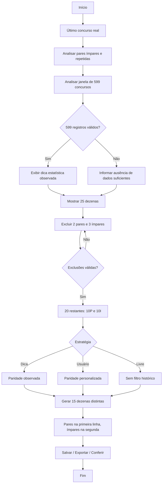

# SuperFácil — [ASD-STE100]
**Protocolo:** ASD-STE100-002-2026-ANEXAR-SEMPRE
**Referência:** 26/10/2026, horário de Brasília.

## 1 — TEXTO
Objetivo: reorganizar o gerador em sequência lógica e com linguagem simples sem sacrificar precisão técnica.

1. Consultar o último concurso real presente na base.
2. Apurar pares, ímpares e, havendo concurso consecutivo, repetidas.
3. Analisar a janela dos **599 concursos** mais recentes registrados.
4. Exibir dica estatística apenas quando a amostra dos 599 estiver disponível.
5. Exibir as 25 dezenas da Lotofácil: **12 pares e 13 ímpares**.
6. Excluir exatamente **2 pares e 3 ímpares**.
7. Restam **10 pares e 10 ímpares**.
8. Escolher estratégia: dica estatística, paridade personalizada ou livre.
9. Gerar jogos distintos com **15 dezenas**, apenas entre as 20 disponíveis.
10. Mostrar pares na primeira linha e ímpares na segunda.
11. Salvar, exportar CSV ou conferir os jogos com concursos disponíveis.

A análise histórica descreve resultados já ocorridos; **não prevê sorteios**. Sem base completa, não oferecer dicas históricas baseadas em dados insuficientes. A geração combinatória continua disponível. Excluir 5 dezenas limita as combinações matemáticas a **C(20,15)=15.504**, sem aumentar a chance de um jogo individual.

## 2 — DIAGRAMA

## 3 — HTML RESPONSIVO
O aplicativo real usa React/TanStack, que renderiza HTML. As mudanças são realizadas em:
- `src/routes/jogar.tsx`: sequência de etapas, seleção equilibrada, filtros, apresentação dos jogos;
- `src/lib/lotofacil.ts`: validação de exclusões e gerador por paridade;
- `src/lib/lotofacil.test.ts`: testes de regressão das regras.

Também foi produzida uma **prévia autônoma em HTML** para visualização local. A prévia não acessa Supabase ou o aplicativo Lovable, e não comprova publicação.

## Verificação
- [x] Texto técnico com regras.
- [x] Diagrama com decisões e saídas.
- [x] Adaptação do aplicativo React na branch de implementação.
- [x] Criação da prévia HTML independente.
- [ ] CI/tests e revisão antes de integrar à `main`.
- [ ] Implantação e teste na hospedagem Lovable.
- [ ] Sincronização automática de resultados oficiais da Caixa.

**Motivo:** consolidar o fluxo de análise → decisão → geração e cumprir a regra 2P + 3I.

**Status:** implementação proposta, sujeita a validação; não é atualização publicada.
